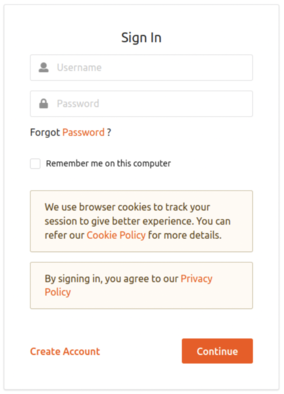
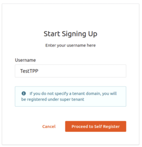
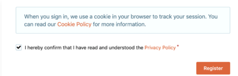
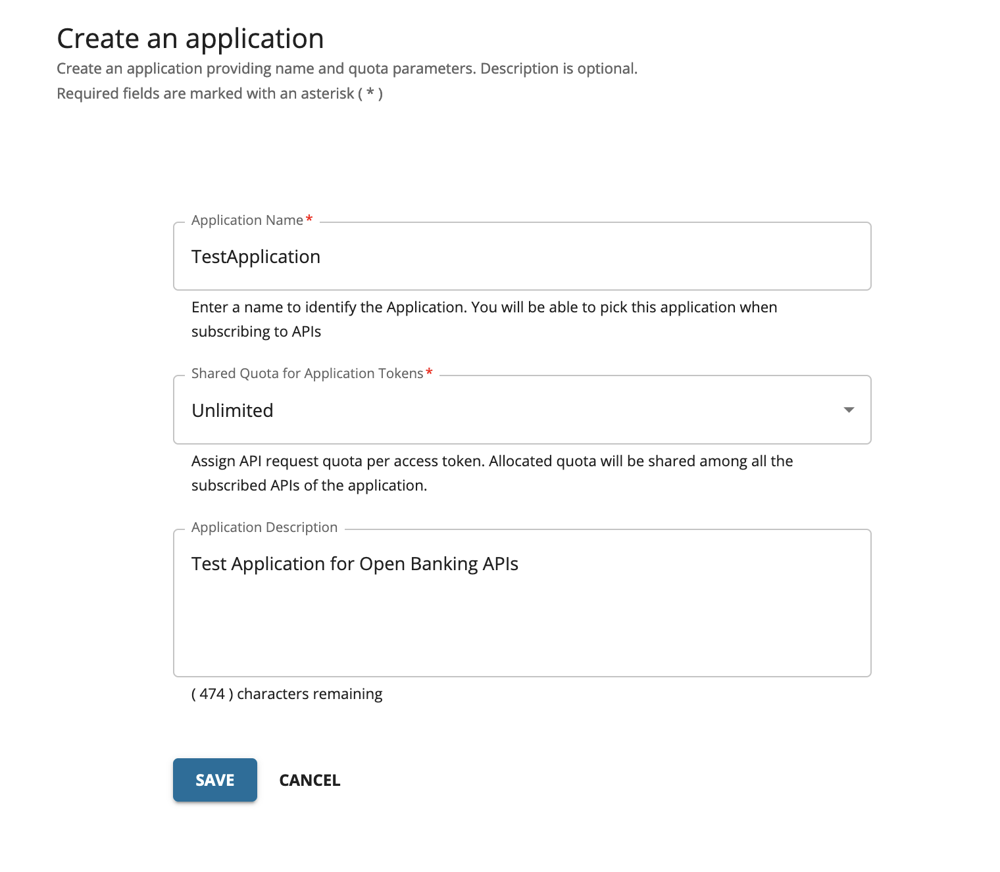
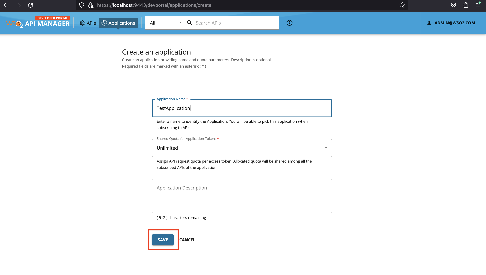
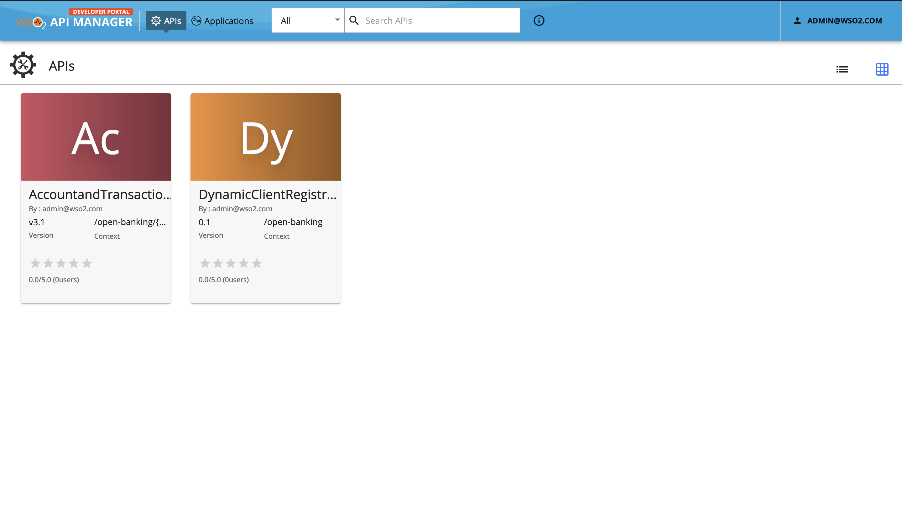
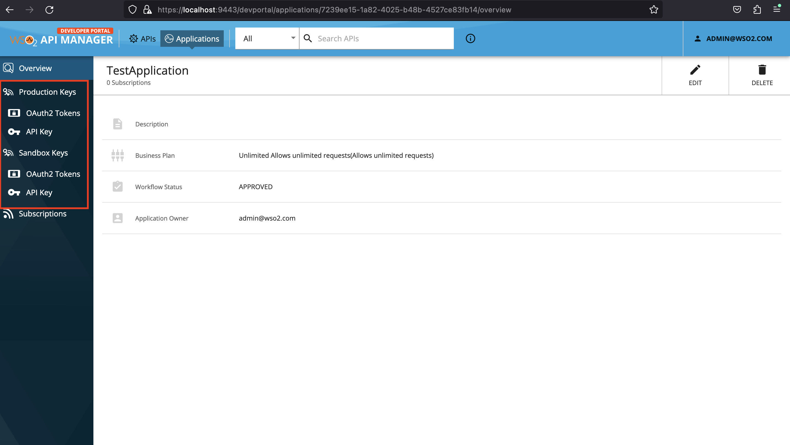
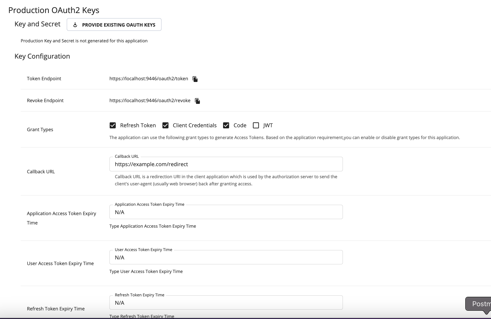
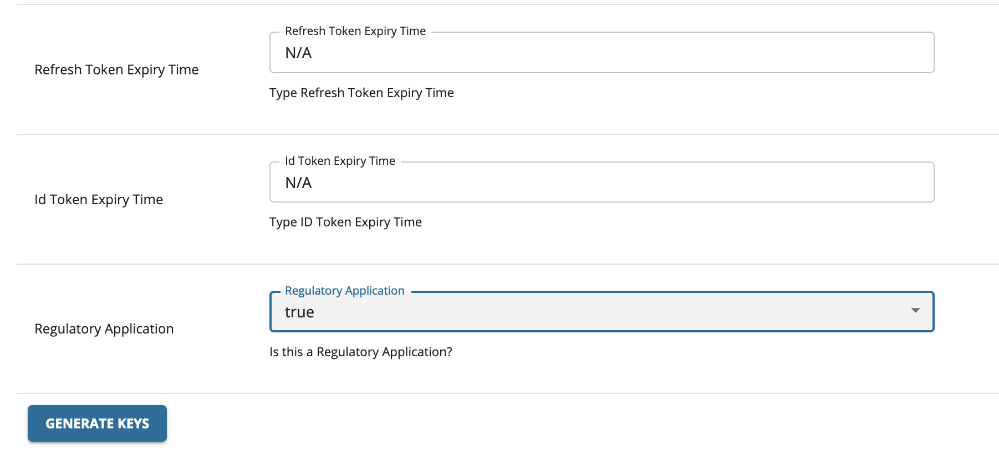
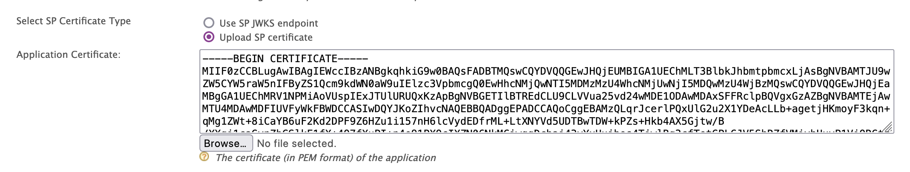

# Using Manual Client Registration Flow

### Step 1: Sign up as a TPP[​](#step-1-sign-up-as-a-tpp "Direct link to Step 1: Sign up as a TPP")

1. Go to the Developer portal at \<https\://\<APIM\_HOST>:9443/devportal>.

2. Go to the **Applications** tab. 

3. In the Sign-in form, click **Create Account**. 

4. Provide a username and click **Proceed Self Register**.  

5. Fill out the **Create New Account** form to complete registration.

6. Read terms and conditions and click the checkbox to agree to the terms and conditions. 

7. Click Register.

### Step 2: Sign in to the Developer Portal as the TPP[​](#step-2-sign-in-to-the-developer-portal-as-the-tpp "Direct link to Step 2: Sign in to the Developer Portal as the TPP")

1. Now, sign in to the Developer portal (`https://<APIM_HOST>:9443/devportal`) as the TPP.

2. Enter the username and the password you entered when signing up as a TPP.

3. Click Continue. Now, you are on the home page of the Developer Portal.

### Step 3: Create an application[​](#step-3-create-an-application "Direct link to Step 3: Create an application")

1. In the Developer Portal, go to the Applications tab. 

2. Click **ADD NEW APPLICATION**. [applications\_tab](/en/3.0.0/assets/img/learn/mcr/create-new-application.png)

3. Enter the following application details. 

4. Click **SAVE**. The Developer Portal displays the created application as follows: 

The application created via the Developer Portal allows you to observe statistics of APIs, subscribe to APIs, and access the subscribed APIs.

### Step 4: Subscribe to API[​](#step-4-subscribe-to-api "Direct link to Step 4: Subscribe to API")

1. Go to the APIs tab in the Developer portal.

2. Select the API. 

3. Go to **Subscriptions** at the bottom of the API and select **SUBSCRIBE**.

4. Select **your application** from the drop-down list then set the **Throttling Policy** and click **SUBSCRIBE**. Once subscribed, the application can access all the supported services of the API resources.

### Step 5: Generate keys[​](#step-5-generate-keys "Direct link to Step 5: Generate keys")

The TPP application requires a Client ID (Consumer Key) to access the subscribed API.

1. Go to the **Applications** tab in the Developer Portal.

2. From the application list, select your application, which has subscribed to the API.

3. Select **Production Keys** > **OAuth2 Tokens or Sandbox Keys** > **OAuth2 Tokens** according to the type of key you require: a. Production Keys: Generates access tokens in the production environment. b. Sandbox Keys: Generates access tokens in the sandbox environment. 

4. Provide the requested information as defined below:

| Field                  | Description                                                                                                                                                                                                                                                                                                                                                                                                                                               |
| ---------------------- | --------------------------------------------------------------------------------------------------------------------------------------------------------------------------------------------------------------------------------------------------------------------------------------------------------------------------------------------------------------------------------------------------------------------------------------------------------- |
| Grant Types            | Determine the credentials that are used to generate the access token. - Code: Relates to the authorisation code grant type and is applicable when consuming the API as a user. **It is mandatory to select the code grant type for regulatory applications.** - Client Credentials: Relates to the client credentials grant type and is applicable when consuming the API as an application. - Refresh Token: To renew an expired access token. |
| Callback URL           | The URL used by the TPP to receive the authorization code sent from the bank. The authorisation code can be used later to generate an OAuth2 access token. **This is a mandatory field for the authorization code grant type.**                                                                                                                                                                                                                      |
| Regulatory Application | The type of application. If your application is compliant with the NextGenPSD2XS2A framework, it is a Regulatory application.                                                                                                                                                                                                                                                                                                                             |

 

5. Click **GENERATE KEYS** to generate production or sandbox keys. It generates the consumer key and consumer secret.

6. Sign in to the Management Console at \<https\://\<IS\_HOST>:9446/carbon/>.

   a. In the Main tab, click **Identity** -> **Service Providers** -> **List**.

   b. Select the Service Provider of the created application, and click the corresponding Edit icon.

   c. Under **Select SP Certificate Type** select Upload SP certificate and upload the certificate.

   

   Certificates can be found in Public Certificate and Private Key.

   d. Expand the **Claim Configuration** section.

   e. Select **<http://wso2.org/claims/username>** from the **Subject Claim URI** list.

   f. Click **Update** to save the configurations.
