# Configure API Resources, Users and Roles

Now you have started the servers, let’s create the API resources, users and define their permissions and roles.

## Sign in to the Identity Server[​](#sign-in-to-the-identity-server "Direct link to Sign in to the Identity Server")

1. Sign in to the Management Console of WSO2 Identity Server at <https://localhost:9446/console>

2. Use the default super admin credentials as follows:

   * Username: <is_admin@wso2.com>
   * Password: wso2123

   note

   The above login credentials are for testing purposes only. It is recommended to change the login credentials in a production environment.

## Create API resources[​](#create-api-resources "Direct link to Create API resources")

WSO2 Identity Server provides comprehensive capabilities for managing and securing API resources, particularly in the context of authorization and access control. You need to create below API resources in order to successfully invoke Open Banking APIs.

| API Resource                                                                 | Identifier                   | Display Names                | Scopes                                         |
| ---------------------------------------------------------------------------- | ---------------------------- | ---------------------------- | ---------------------------------------------- |
| API Resource for access scopes attached to customer facing Open Banking APIs | User-defined-oauth2-resource | User-defined-oauth2-resource | accounts payments fundsconfirmations |
| API resource to acccess internal Open Banking APIs provided by WSO2          | OB-internal-api-resource     | OB-internal-api-resource     | ob-internal-api-access                         |

Follow the below steps to create the above API Resources.

1. Go to the **Api Resources** tab in the left pane.

2. Click **New API Resource**.

   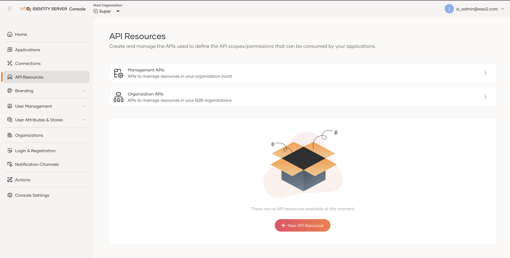

3. Enter **Identifier** and **Display Names**.

   | Text Field    | Value                        |
   | ------------- | ---------------------------- |
   | Identifier    | User-defined-oauth2-resource |
   | Display Names | User-defined-oauth2-resource |

   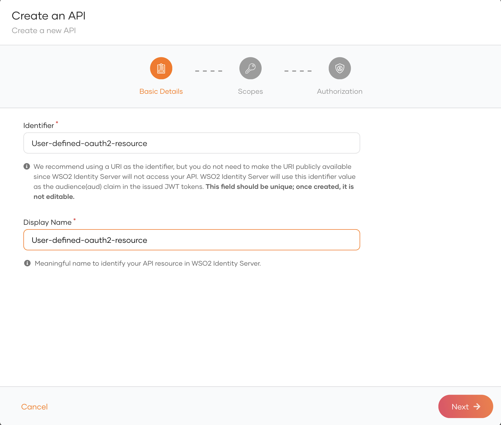

4. Click **Next**.

5. Add the following scopes one at a time: **accounts**, **payments**, and **fundsconfirmations**. For each scope, enter the Scope and Display Name as shown below. 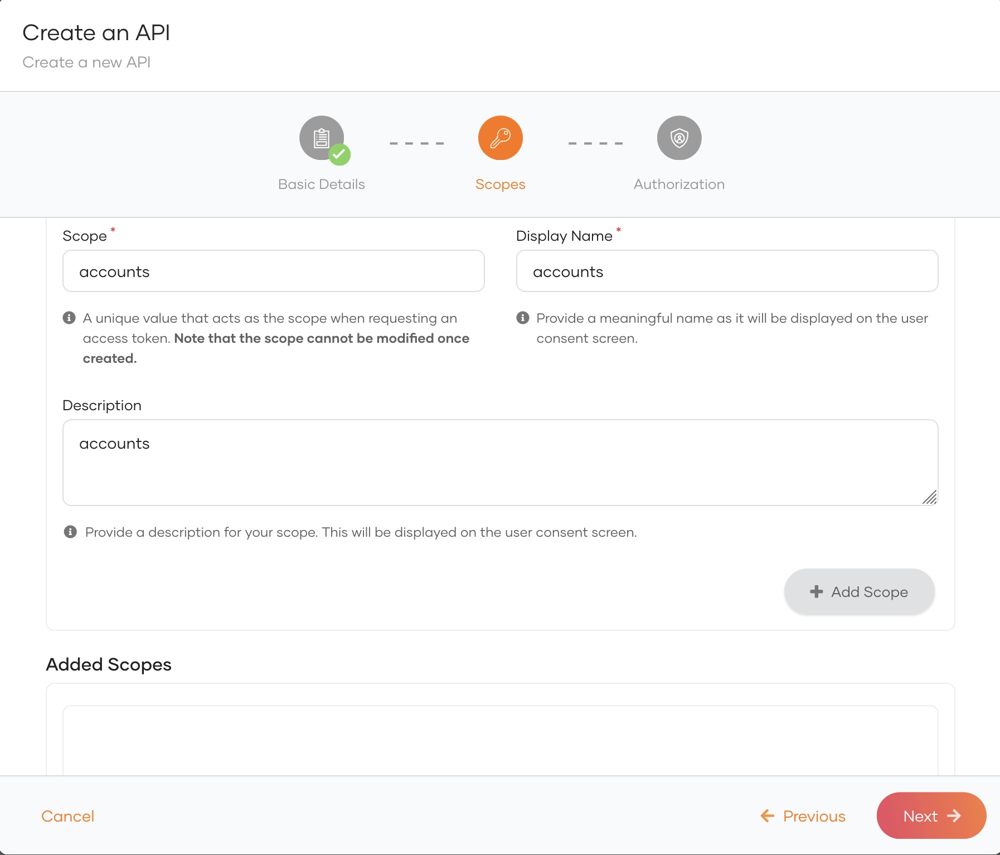

6. Once all scopes have been added, they will be displayed as shown below. 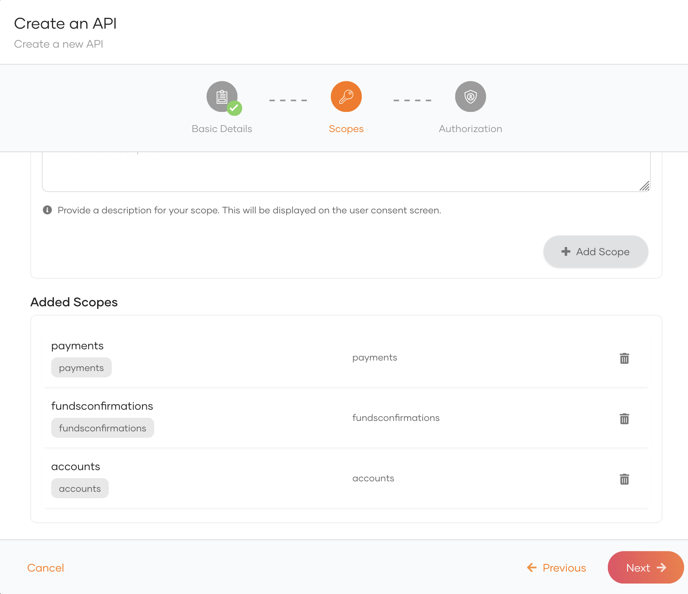

7. Click **Next**.

8. Click **Create**.

   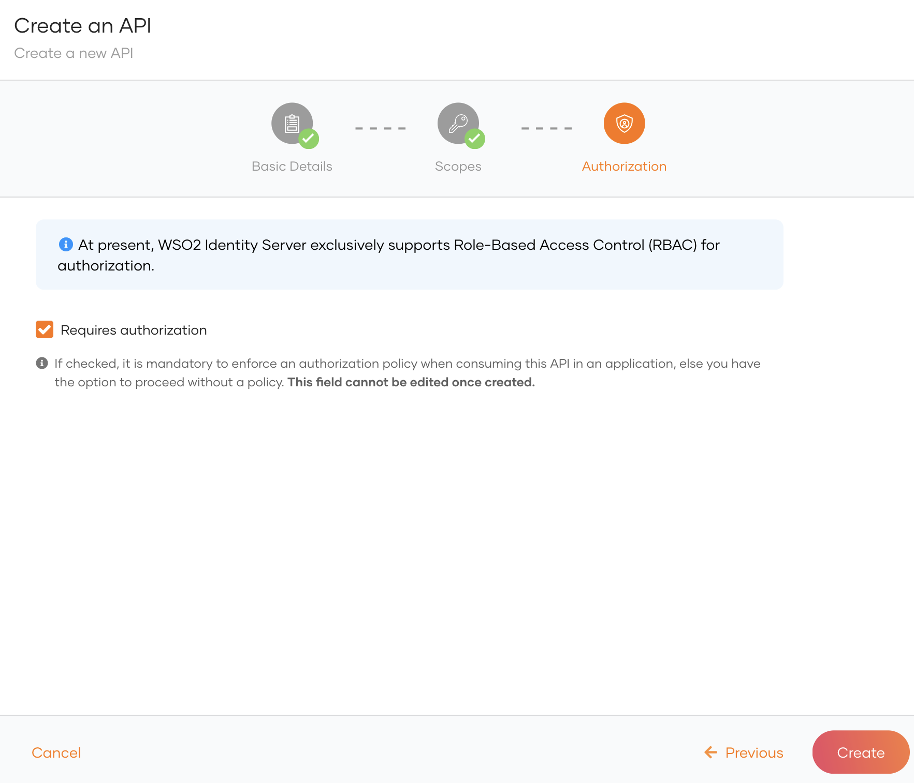

9. Create **OB-internal-api-resource** by flowing the above steps.

## Create new user roles[​](#create-new-user-roles "Direct link to Create new user roles")

1. Go to the **User Management** tab in the left pane and select **Roles**. 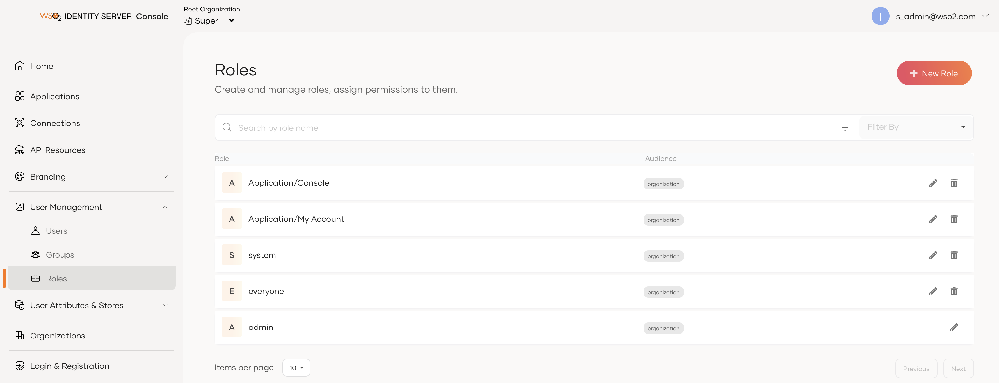

2. Click **+ New Role**.

3. Create the following user role:

   | Role Name               | Role audience | Permissions                  | Description                                                                                     |
   | ----------------------- | ------------- | ---------------------------- | ----------------------------------------------------------------------------------------------- |
   | consumer                | Organization  | User-defined-oauth2-resource | Users must have the `Consumer` role to proceed with the authorization flow.                     |
   | OBInternalApiAccessRole | Organization  | OB-internal-api-resource     | Users must have the `OBInternalApiAccessRole` role to access internal OB APIs provided by WSO2. |

   i. Creating **consumer role**:

   * Enter the role name as **consumer** and select the role audience as **Organization**:

     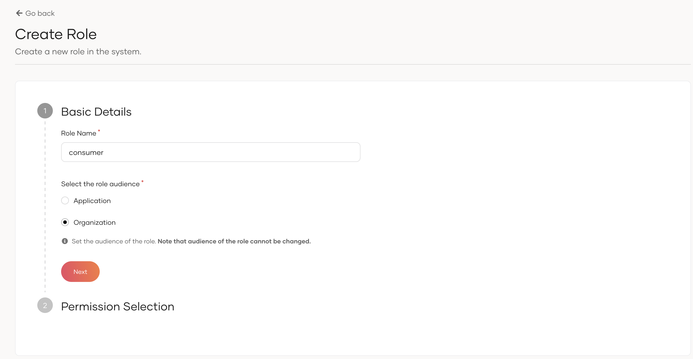

   * Click **Next**.

   * Select the API Resource `User-defined-oauth2-resource` created in [Create API resources](#create-api-resources).

   * Select all three permissions of the `User-defined-oauth2-resource` resource.

     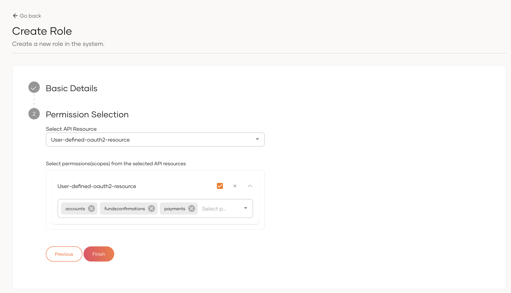

   * Click **Finish**.

   ii. Creating **OBInternalApiAccessRole role**:

   * Enter the role name as **OBInternalApiAccessRole** and select the role audience as **Organization**:

     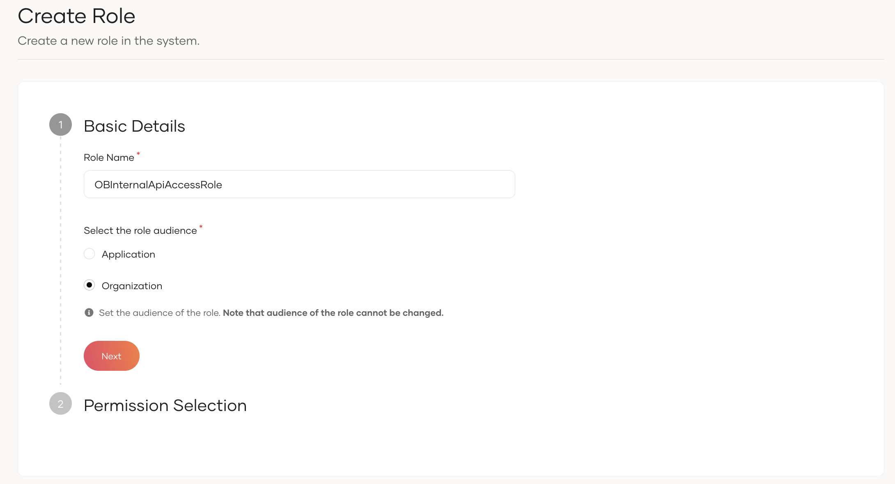

   * Click **Next**.

   * Select the API Resource `OB-internal-api-resource` created in [Create API resources](#create-api-resources).

   * Select all permissions of the `OB-internal-api-resource` resource.

     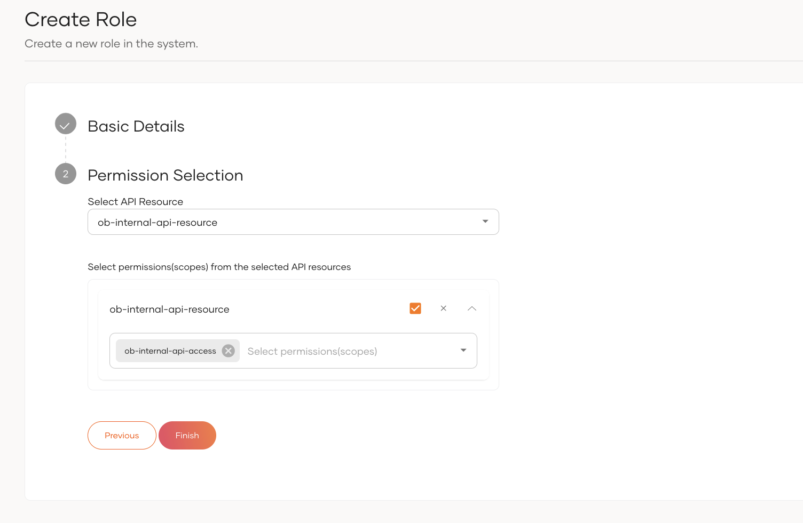

   * Click **Finish**.

## Create new users[​](#create-new-users "Direct link to Create new users")

1. Go to the **User Management** tab in the left pane and select **Users**. 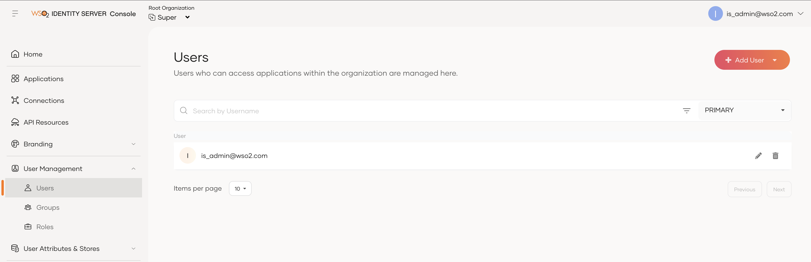

2. Click **Add User** → **Single User**.

3. Enter the basic details of the user and set a password. Select `PRIMARY` user store.

   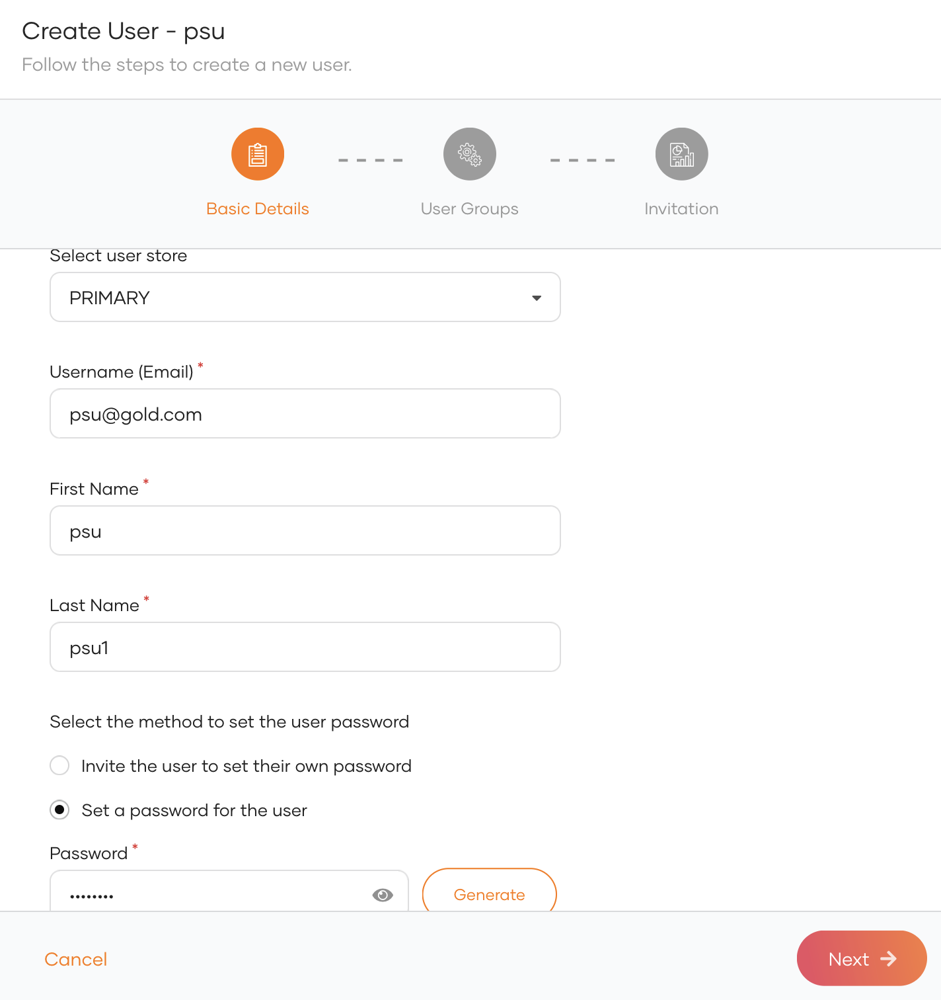

4. Click **Next**.

   note

   Select the admin group, If you want to add the user to the admin group. Otherwise, continue without selecting the Admin group.

5. Click **Save and Continue**. 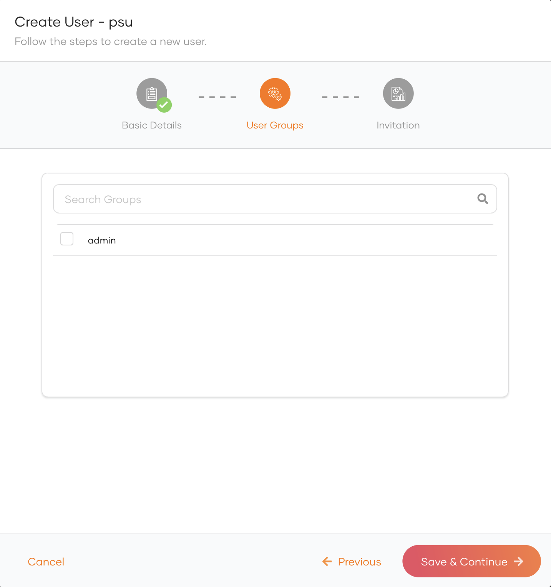

6. Click **Close**.

## Assign roles to the user[​](#assign-roles-to-the-user "Direct link to Assign roles to the user")

1. Go to the **User Management** tab in the left pane and select **Roles**. 

2. Click on the **consumer** role created in [Create new user roles](#create-new-user-roles) 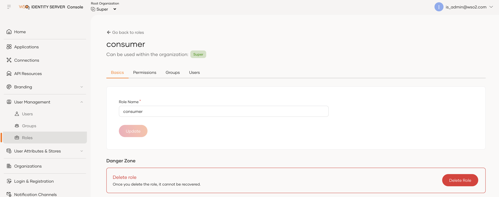

3. Go to **Users** tab.

4. Click **Assign Users**. 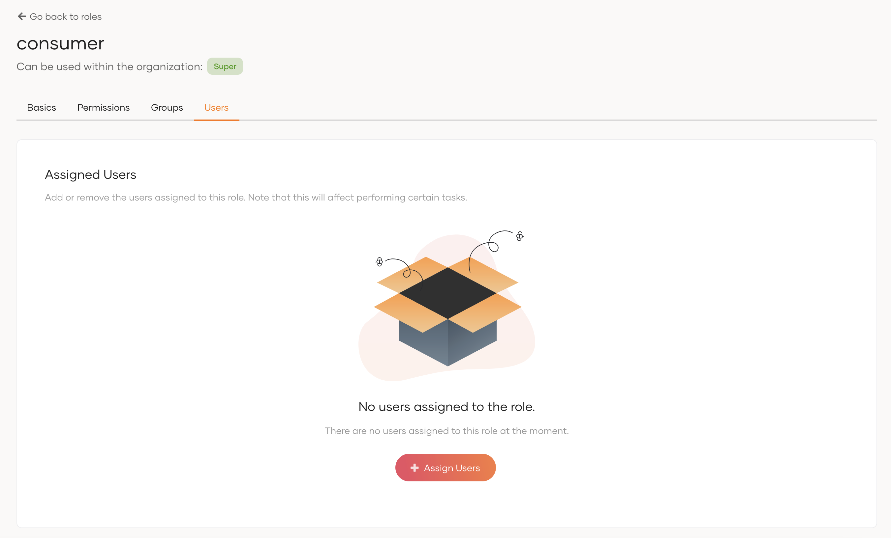

5. Click **Assign User** drop-down → select user from the drop-down. 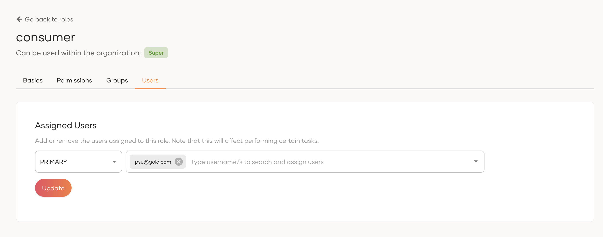

6. Click **Update**.

7. Similarly assign **OBInternalApiAccessRole** to the admin user in your system.
