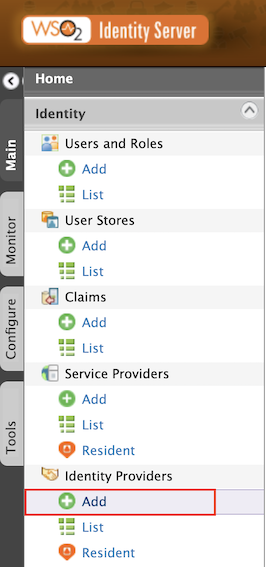
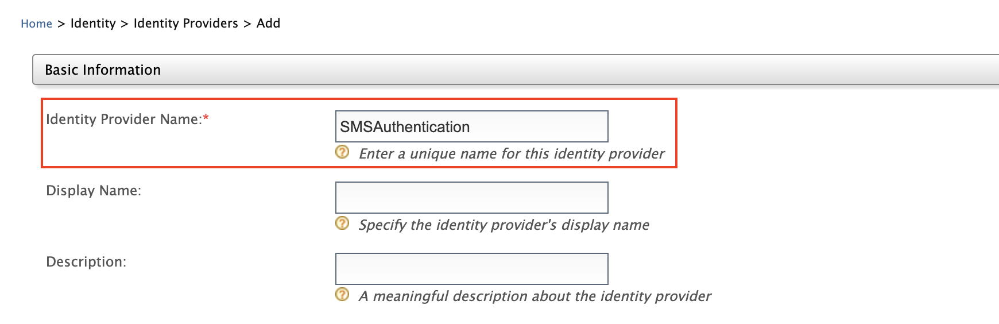
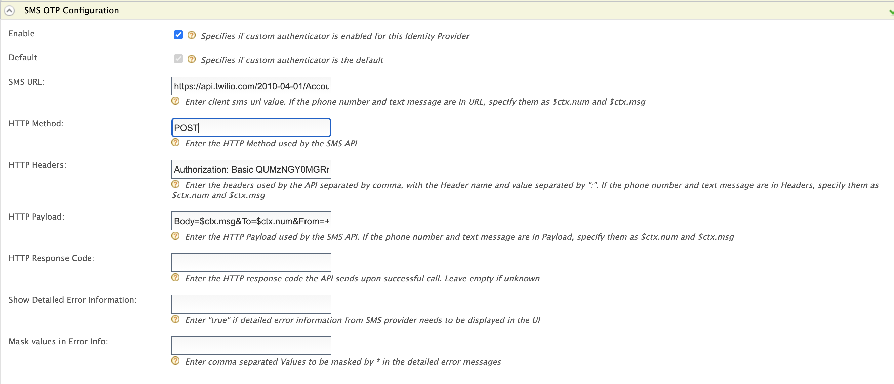
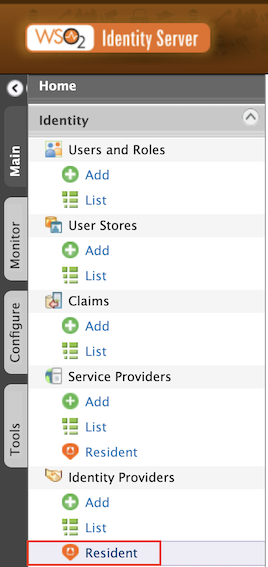
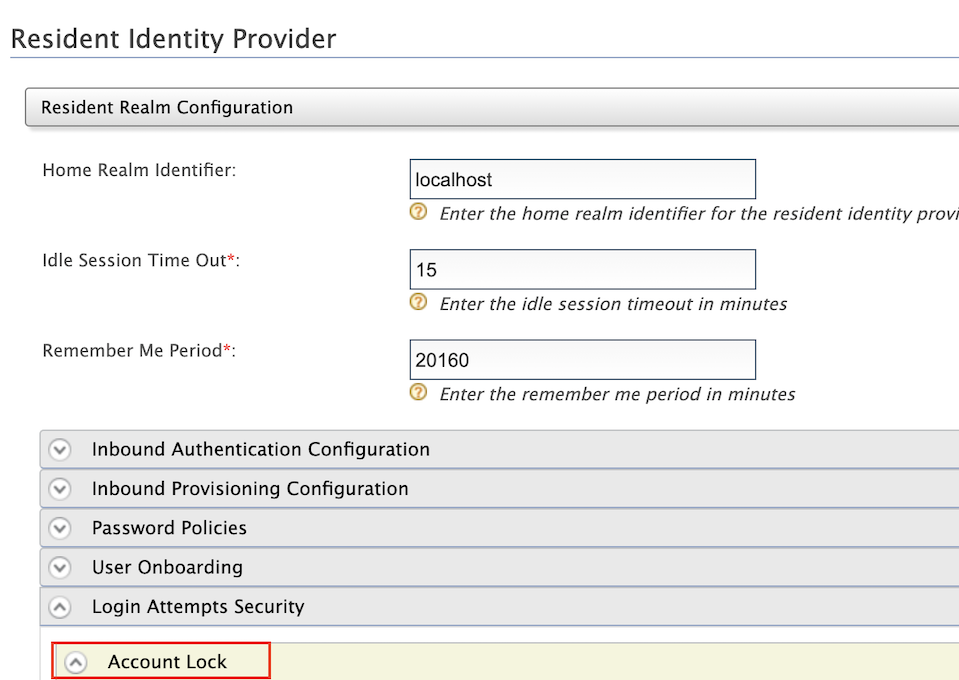
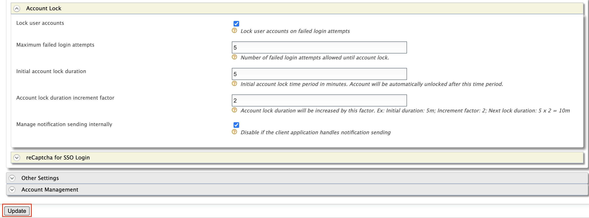
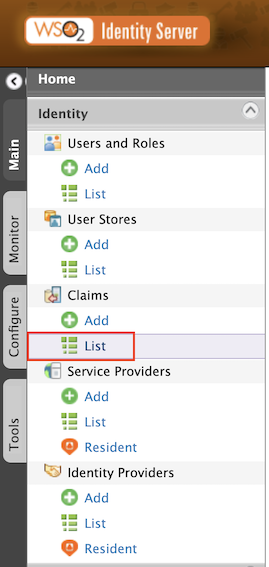
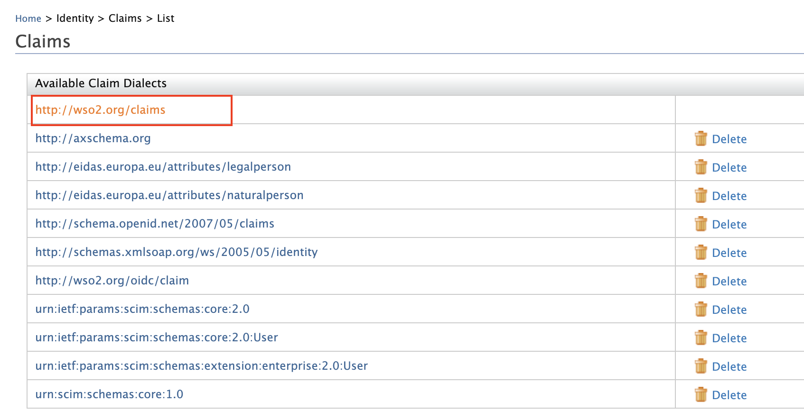
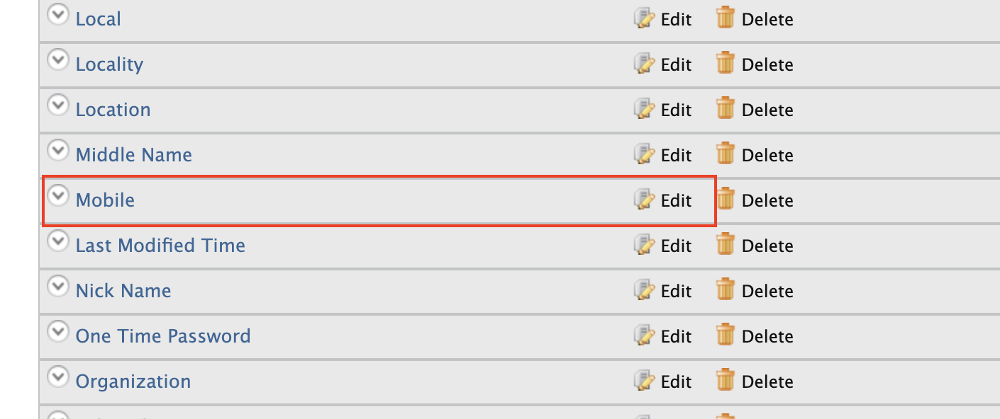
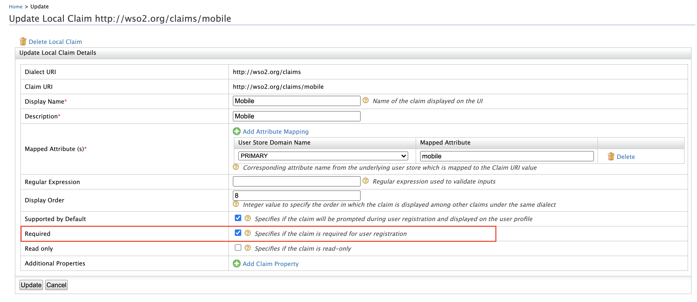

# Identifier first

**Identifier-first authentication** allows identifying the individuals prior to authenticating them. It retrieves the identity of the user without using authentication information and uses that identity to control the authentication flow.

You can implement identifier-first authentication using a custom local authenticator. For more information, see [Identifier-first Flow Handler](https://is.docs.wso2.com/en/5.11.0/learn/identifier-first-flow-handler/#configuring-identifier-first-handler-in-the-login-flow). WSO2 Open Banking consists of an identifier-first authenticator by default. Configure identifier-first authentication in two stages as given in the below instructions:

* Before server start
* After server start

### Before server start[​](#before-server-start "Direct link to Before server start")

If you have not started the Identity Server and API Manager servers, follow the below instructions to configure identifier-first authentication.

1. Locate the following configuration in `<IS_HOME>/repository/conf/deployment.toml` and update the value of the `parameters.authRequestURL`<br /><!-- -->configuration with the host name of the Identity Server:

   ```
   [[authentication.custom_authenticator]]

   name = "IdentifierExecutor"

   parameters.ValidateUsername = true

   parameters.throttleLimit = 3

   parameters.throttleTimePeriod = 300

   parameters.authRequestURL = "https://<IS_HOST>:9446/api/identity/auth/v1.1/data/AuthRequestKey/"


   [authentication.authenticator.sms_otp.parameters]

   EnableAccountLockingForFailedAttempts = true

   BackupCode = false

   TokenExpiryTime = 60
   ```

2. Add the following configuration in `<IS_HOME>/repository/conf/deployment.toml` to make the default identifier-first authenticator the primary authenticator:

   ```
   [open_banking.sca.primaryauth]

   name = "IdentifierExecutor"

   display = "ob-identifier-first"
   ```

3. Update the `<IS_HOME>/repository/conf/common.auth.script.js` file with the following steps:

   ```
   var psuChannel = 'Online Banking';


   function onLoginRequest(context) {

       publishAuthData(context, "AuthenticationAttempted", {'psuChannel': psuChannel});

       doLogin(context);

   }


   var doLogin = function(context) {

       executeStep(1, {

           onSuccess: function (context) {

               //identifier-first success

           Log.info("Authentication Successful");

               publishAuthData(context, "AuthenticationSuccessful", {'psuChannel': psuChannel});

               OTPFlow(context);

           },

           onFail: function (context) { //identifier-first fail

           Log.info("Authentication Failed");

               publishAuthData(context, "AuthenticationFailed", {'psuChannel': psuChannel});

               doLogin(context);

           }

       });

   };


   var OTPFlow = function(context) {

       executeStep(2, {

                //OTP-authentication

           onSuccess: function (context) {

               context.selectedAcr = "urn:cds.au:cdr:2";

               publishAuthData(context, "AuthenticationSuccessful", {'psuChannel': psuChannel});

           },

           onFail: function (context) {

               publishAuthData(context, "AuthenticationFailed", {'psuChannel': psuChannel});

               OTPFlow(context);

           }

       });

   };
   ```

4. If you are using **WSO2 Open Banking Identity Server Accelerator Level 3.0.0.78 or above,** add the following configuration to the `<IS_HOME>/repository/conf/deployment.toml` file to set authenticator steps.

   ```
   [open_banking.sca.idp]

   name = "<IDP_NAME>"

   step = "<IDP_STEP>"
   ```

   For example, to add the SMS Authenticator IDP named `SMSAuthentication` as the second authenticator step, add the following configuration:

   ```
   [open_banking.sca.idp]

   name = "SMSAuthentication"

   step = "2"
   ```

### After server start[​](#after-server-start "Direct link to After server start")

If you have already started the Identity Server and API Manager servers, follow the below instructions to configure identifier-first authentication.

#### Configuring SMS OTP authenticator[​](#configuring-sms-otp-authenticator "Direct link to Configuring SMS OTP authenticator")

1. Sign in to WSO2 Identity Server Management Console at `https://<IS_HOST>:9446/carbon`.

2. On the **Main** tab, click **Home > Identity > Identity Providers > Add**. 

3. Give `Identity Provider Name` as `SMSAuthentication`. 

4. Expand **Federated Authenticators > SMS OTP Configuration**.

5. Select both the **Enable** and **Default** checkboxes. This is to enable and make the `SMSAuthentication` authenticator the default one. Based on your SMS provider, fill out the SMS OTP configurations.

   note

   Currently, WSO2 Identity Server supports only the following SMS providers.

   * Twilio
   * Nexmo
   * Clickatell
   * Plivo
   * Bulksms

   If Twilio is used as the SMS provider,

   1. Go to <https://www.twilio.com/try-twilio> and create an account.
   2. While registering the account, verify your mobile number and click on console home <https://www.twilio.com/console> to get free credits (Account SID and Auth Token).
   3. Twilio uses a POST method with headers and the text message and phone number are sent as the payload. So the fields would be as follows:

   | SMS URL      | `https://api.twilio.com/2010-04-01/Accounts/%7BAccountSID%7D/SMS/Messages.json` |
   | ------------ | ------------------------------------------------------------------------------- |
   | HTTP Method  | `POST`                                                                          |
   | HTTP Headers | `Authorization: Basic base64{AccountSID:AuthToken}`                             |
   | HTTP Payload | `Body=$ctx.msg&To=$ctx.num&From=urlencode{TrialNumber}`                         |

   note

   If you pass the text message and the phone number in any field, you have to replace them with `$ctx.num` and `$ctx.msg` respectively. For example, `Body=$ctx.msg&To=$ctx.num&From=+12345678`.

   

6. Click **Register** to add the Identity Provider.

#### Configure account locking[​](#configure-account-locking "Direct link to Configure account locking")

1. On the **Main** tab, click **Home > Identity > Identity Providers > Resident**. 
2. Expand **Login Attempts Security > Account Lock**. 
3. Select **Lock user accounts** and click **Update**. 

#### Configure mobile as a mandatory claim[​](#configure-mobile-as-a-mandatory-claim "Direct link to Configure mobile as a mandatory claim")

1. On the **Main** tab, click **Home > Identity > Claims > List**.

   

2. Select `http://wso2.org/claims` from the list. 

3. Locate **Mobile** from the list and select **Edit**. 

4. Select **Required** and click **Update**. 
