# Deploy Open Banking APIs

This page explains how to deploy an Open Banking API.

Before publishing the APIs, you need to create the consumer role in WSO2 API Manager.

## Create Consumer Role APIM Console[​](#create-consumer-role-apim-console "Direct link to Create Consumer Role APIM Console")

1. Goto APIM Carbon Console: `https://<APIM_HOSTNAME>:9443/carbon`

2. Log into APIM Carbon Console using APIM admin username and password.

3. Click on Main Tab → Users and Roles → Add

4. Click on Add New Role. 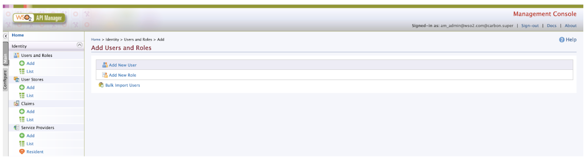

5. Enter role Details: 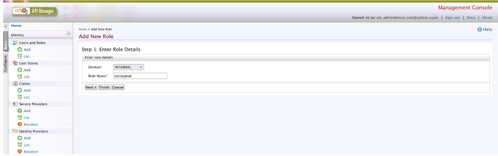

   | Domain   | Role Name |
   | -------- | --------- |
   | INTERNAL | consumer  |

6. Click on Finish.

## Publish Open Banking APIs[​](#publish-open-banking-apis "Direct link to Publish Open Banking APIs")

note

WSO2 Open Banking Accelerator supports Accounts flow, Payments flow and Confirmation of Funds flow. Publish all three APIs before trying out the flows.

1. Sign in to the API Publisher Portal at `https://<APIM_HOSTNAME>:9443/publisher`.

2. In the homepage, go to REST API and select Import Open API. 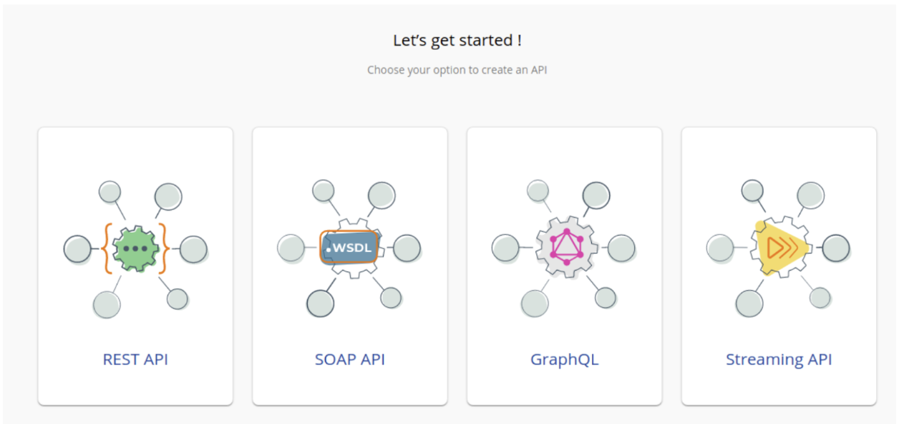

3. Select OpenAPI File/Archive. 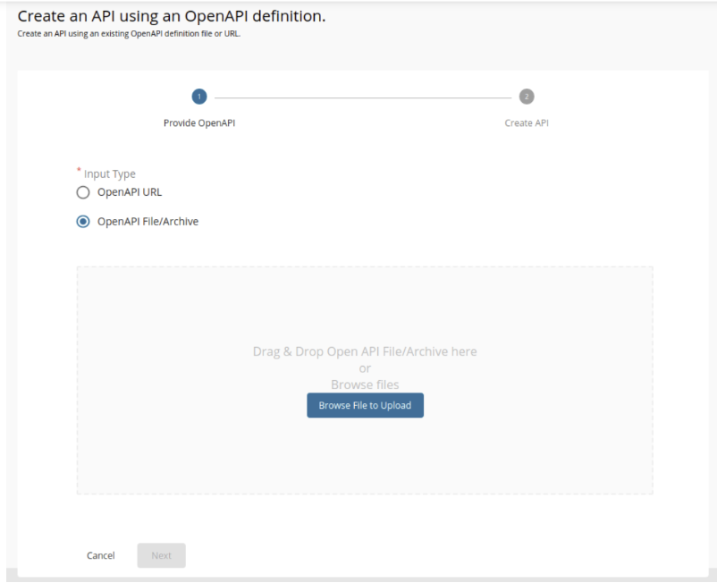

4. Click Browse File to Upload and select the required yaml file.

   | API                   | Swagger File                                                                                                                                                                                                                           |
   | --------------------- | -------------------------------------------------------------------------------------------------------------------------------------------------------------------------------------------------------------------------------------- |
   | Accounts              | [account-info-swagger.yaml](https://github.com/wso2/financial-services-accelerator/blob/4.0.0/financial-services-accelerator/accelerators/fs-apim/repository/resources/apis/Accounts/account-info-swagger.yaml)                        |
   | Payments              | [payment-initiation-openapi.yaml](https://github.com/wso2/financial-services-accelerator/blob/4.0.0/financial-services-accelerator/accelerators/fs-apim/repository/resources/apis/Payments/payment-initiation-openapi.yaml)            |
   | Confirmation of Funds | [funds-confirmation-openapi.yaml](https://github.com/wso2/financial-services-accelerator/blob/4.0.0/financial-services-accelerator/accelerators/fs-apim/repository/resources/apis/ConfirmationOfFunds/funds-confirmation-openapi.yaml) |

5. Click Next.

6. Set the Context value as follows:

   | API                   | Context Value                   |
   | --------------------- | ------------------------------- |
   | Accounts              | `/open-banking/{version}/aisp`  |
   | Payments              | `/open-banking/{version}/pisp`  |
   | Confirmation of Funds | `/open-banking/{version}/cbpii` |

7. Leave the Endpoint field empty as it is, Select the Gateway Type and click Create. 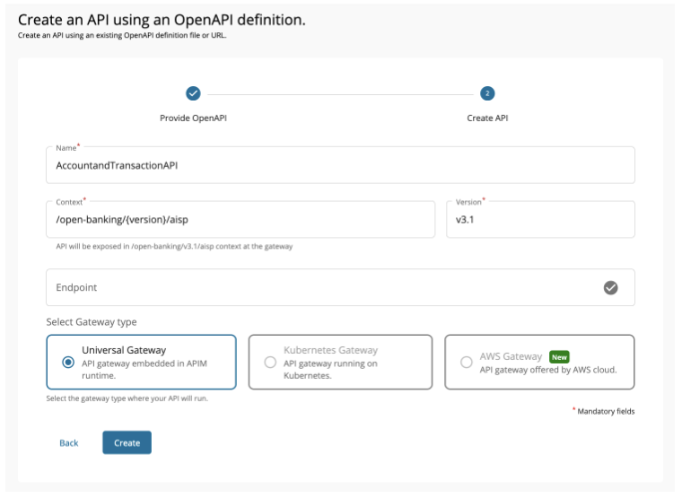

8. Select Subscriptions from the left menu pane and uncheck all subscription plans. 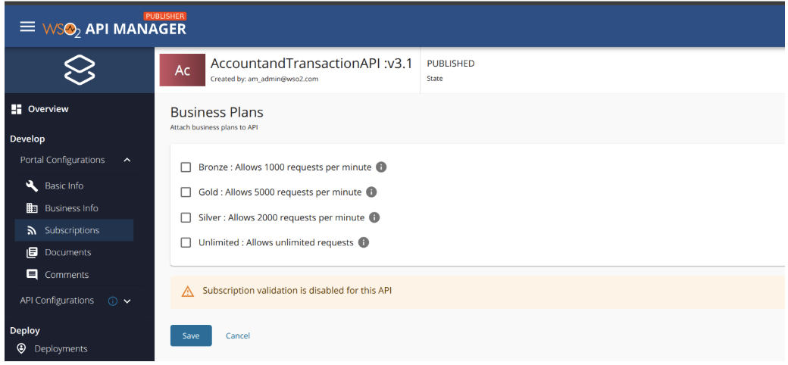

9. Click Save.

10. Go to Runtime using the left menu pane. 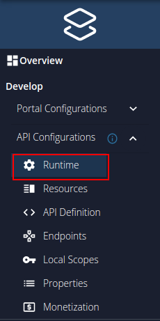

11. Toggle the Schema Validation button to enable Schema Validation for all APIs except for the Dynamic Client Registration API. 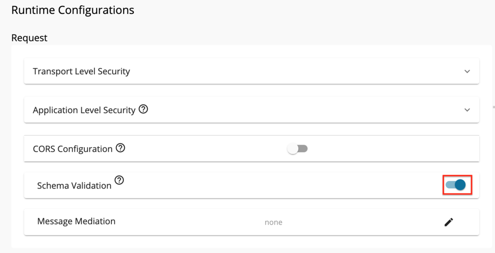

12. Go to Endpoints using the left menu pane. 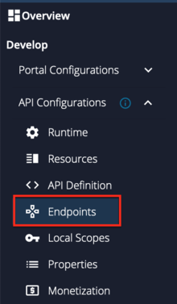

13. Select the endpoint types; **Dynamic Endpoints** and click Save. 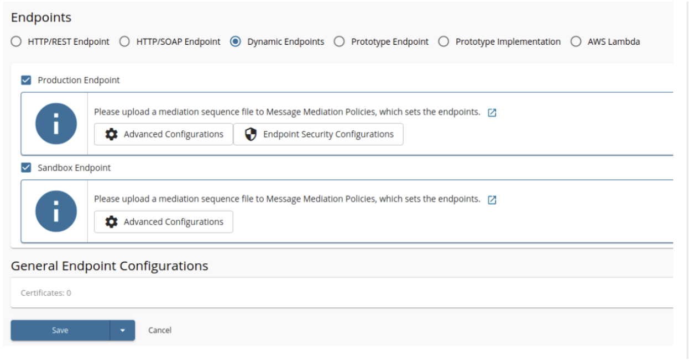

14. Add [JWT claim based access validation](https://apim.docs.wso2.com/en/latest/design/api-policies/regular-gateway-policies/jwt-claim-based-access-validator/).

    Use **aut** as the Access verification claim name and value from below.

    | Token Type               | Claim Value       |
    | ------------------------ | ----------------- |
    | Client Credentials Grant | APPLICATION       |
    | Authorization Code Grant | APPLICATION\_USER |

15. Create and engage the required [Inbuilt Gateway Enforcements](/en/4.0.0/learn/inbuilt-policies/.md)

    * Refer to the [Introduction to Policies](/en/4.0.0/learn/policies/.md) for more details on Policies.
    * Refer to the [Create Policies](/en/4.0.0/learn/create-policies/.md) for create new Policies.
    * Refer to the [Engage Policies](/en/4.0.0/learn/engage-policies/.md) to learn how to engage policies to an API.

    Refer to the below table and engage the required policies for each API.

    | API                   | API Level Policies        | Operational Level Policies                                  |
    | --------------------- | ------------------------- | ----------------------------------------------------------- |
    | Accounts              | `MTLS Enforcement Policy` | `Consent Enforcement Policy` `Dynamic Endpoint Policy` |
    | Payments              | `MTLS Enforcement Policy` | `Consent Enforcement Policy` `Dynamic Endpoint Policy` |
    | Confirmation of Funds | `MTLS Enforcement Policy` | `Consent Enforcement Policy` `Dynamic Endpoint Policy` |

16. Select the **API Gateway** type, in this scenario, it is **Default**.

17. Click Deploy.

18. Go to Overview using the left menu pane. 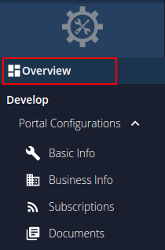

19. click Publish. 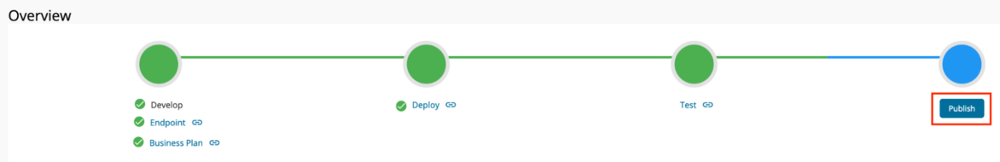

Once you deploy the APIs an API resource will be created along with the role mentioned in the swagger on the Identity Server side.

note

If you have created the users, assign the roles created while publishing the APIs to the users.
