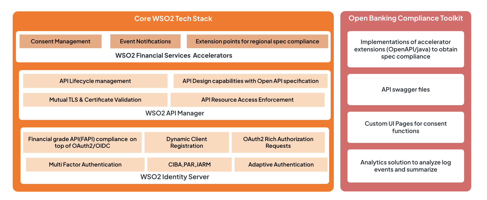

WSO2 Open Banking Accelerator is a collection of technologies that increases the speed and reduces the complexity
of adopting open banking compliance. Instead of building a solution from scratch, you can use WSO2 Open Banking
Accelerator to meet all legislative requirements with additional benefits beyond compliance.

Get a head start with our Quick Start Guide or dive straight into the documentation to understand what we offer
and to discover the extensibility.

  <iframe
    src="https://www.youtube.com/embed/k9mGnuwQdao"
    title="What is WSO2 Open Banking"
    frameBorder="0"
    allow="accelerometer; autoplay; encrypted-media; gyroscope; picture-in-picture"
    referrerPolicy="strict-origin-when-cross-origin"
    allowFullScreen
  ></iframe>

- [Quick Start Guide](quick-start-guide.md): Set up and try out in your local environment
- [Consent Management](../learn/consent-management.md): Create, view, revoke, and manage consents
- [Dynamic Client Registration](../learn/dynamic-client-registration.md): A thorough verification before onboarding
- [Secured API Invocation](../learn/api-security.md): Comprehensive support of FAPI and eIDAS certificate validation
- [Analytics and Data Publishing](../learn/data-publishing.md): Publish and summarize data for reporting
- [Easily Pluggable](../learn/integration.md): Easy integration with core banking systems
- [Develop toolkit](../develop/develop-toolkit.md): Customize features according to your open banking requirements

## What is an open banking accelerator?

An open banking accelerator provides the base technology for financial institutions to meet open banking compliance. 
It accelerates open banking adoption by providing the required technology stack to cater to open banking requirements 
so that you don't have to build a solution from scratch. This can accelerate your pathway of reaching defined goals in 
open banking compliance, technology, and business goals.  

## WSO2 Open Banking Accelerator

WSO2 Open Banking Accelerator is a collection of technologies that increases the speed and reduces the complexity of 
adopting open banking compliance. Instead of building a solution from scratch, you can use WSO2 Open Banking 
Accelerator to meet all legislative requirements with additional benefits beyond compliance. The accelerator run on top 
of WSO2 Identity Server and WSO2 API Manager. Given below is the model of WSO2 Open Banking Accelerator:

The accelerator mainly addresses the open banking requirements such as API consumer application onboarding, consent 
management, and access authorization among numerous other [features](../learn/consent-management.md) to set up an open 
banking solution. You can easily [implement a toolkit](../develop/develop-toolkit.md) to customize the accelerator and 
help you comply with any regional open banking standard. 

Open banking provides a great opportunity for financial institutions to reinvent their legacy systems using 
fast-developing technologies. [WSO2 Open Banking Accelerator](https://wso2.com/solutions/financial/open-banking) 
delivers comprehensive technology and strategic consultancy to help you execute standards-compliant, commercially 
successful open banking initiatives.  
