# Deploy Open Banking APIs

This page explains how to deploy an Open Banking API.

Before publishing the APIs, you need to create the consumer role in WSO2 API Manager.

## Create Consumer Role APIM Console[​](#create-consumer-role-apim-console "Direct link to Create Consumer Role APIM Console")

1. Goto APIM Carbon Console: `https://<APIM_HOSTNAME>:9443/carbon`

2. Log into APIM Carbon Console using APIM admin username and password.

3. Click on Main Tab → Users and Roles → Add

4. Click on Add New Role. 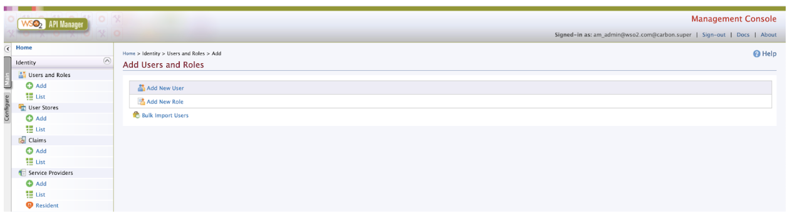

5. Enter role Details:

   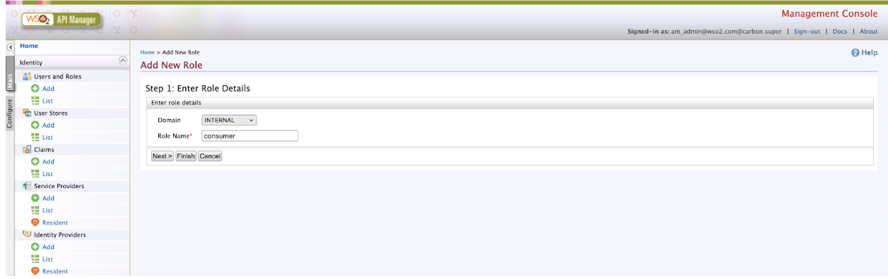

   | Domain   | Role Name |
   | -------- | --------- |
   | INTERNAL | consumer  |

6. Click on Finish.

## Publish Accounts API[​](#publish-accounts-api "Direct link to Publish Accounts API")

1. Sign in to the API Publisher Portal at `https://<APIM_HOSTNAME>:9443/publisher`.

2. In the homepage, go to REST API and select Import Open API.<br />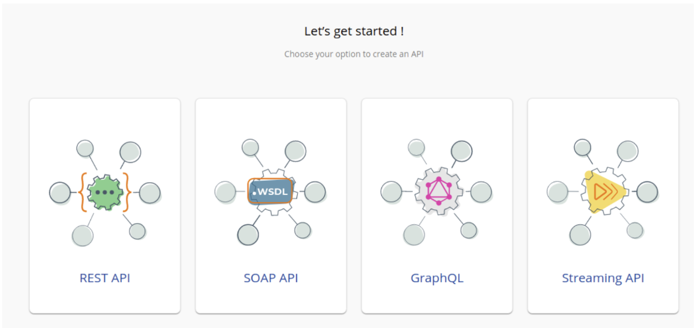

3. Select OpenAPI File/Archive.<br />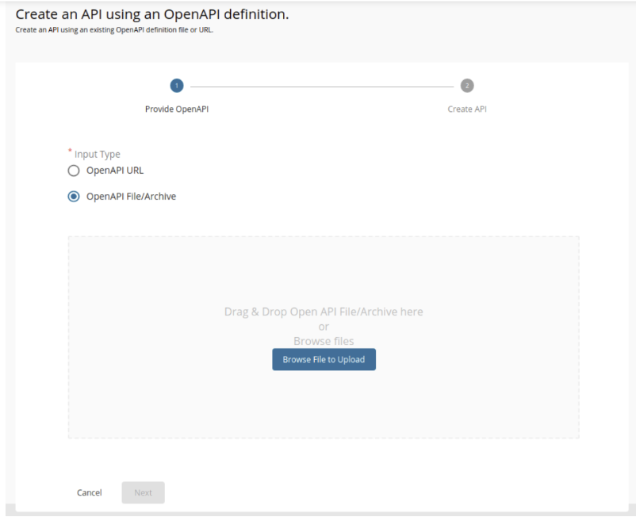

4. Click Browse File to Upload and select [account-info-swagger.yaml](https://github.com/wso2/financial-services-accelerator/blob/4.0.0/financial-services-accelerator/accelerators/fs-apim/repository/resources/apis/Accounts/account-info-swagger.yaml).

5. Click Next.

6. Set the Context value as follows:

   ```
   /open-banking/{version}/aisp
   ```

7. Leave the Endpoint field empty as it is, Select the Gateway Type and click Create.<br />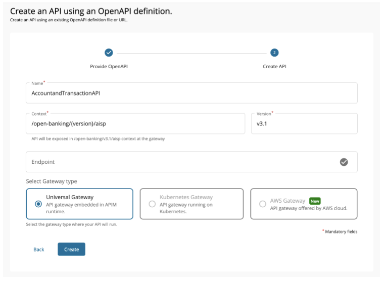

8. Select Subscriptions from the left menu pane and uncheck all subscription plans.<br />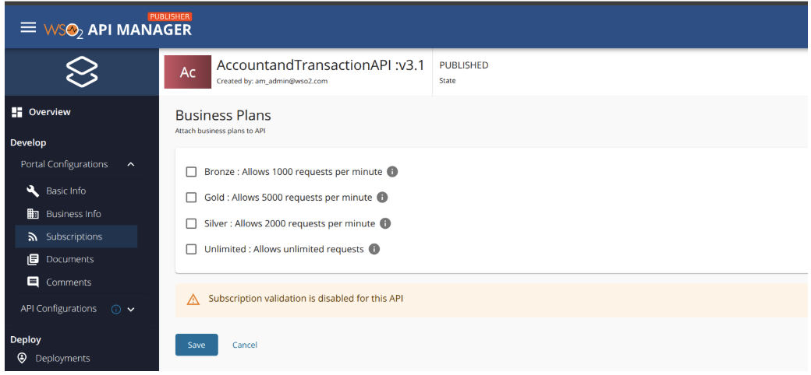

9. Click Save.

10. Go to Runtime using the left menu pane.<br />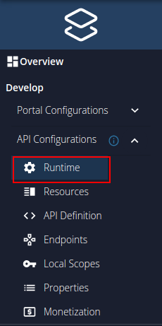

11. Toggle the Schema Validation button to enable Schema Validation for all APIs except for the Dynamic Client Registration API.<br />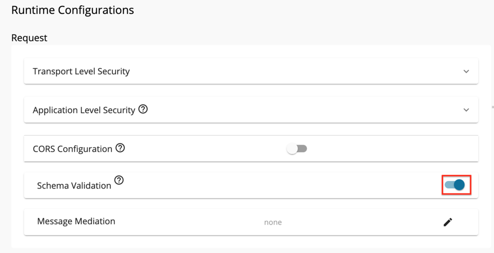

12. Add [JWT claim based access validation](https://apim.docs.wso2.com/en/latest/design/api-policies/regular-gateway-policies/jwt-claim-based-access-validator/).

    Use aut as the Access verification claim name and value from below.

    | Token Type               | Claim Value       |
    | ------------------------ | ----------------- |
    | Client Credentials Grant | APPLICATION       |
    | Authorization Code Grant | APPLICATION\_USER |

13. Go to Endpoints using the left menu pane.<br />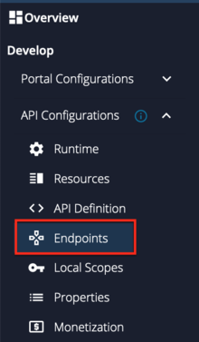

14. Select the endpoint types; `Dynamic Endpoints` and click Save.<br />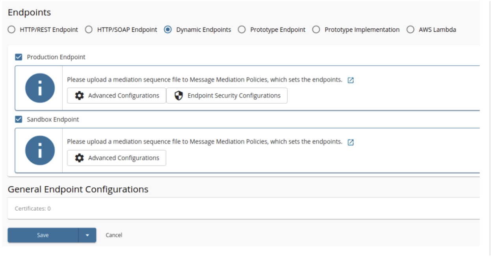

15. Create and engage the required [Inbuilt Gateway Enforcements](/en/latest/learn/inbuilt-policies/.md)

    * Refer to the [Introduction to Policies](/en/latest/learn/policies/.md) for more details on Policies.
    * Refer to the [Create Policies](/en/latest/learn/create-policies/.md) for create new Policies.
    * Refer to the [Engage Policies](/en/latest/learn/engage-policies/.md) to learn how to engage policies to an API.

    Engage the following policies.

    * `MTLS Enforcement Policy`
    * `Consent Enforcement Policy`
    * `Dynamic Endpoint Policy`

16. Select the API Gateway type, in this scenario, it is Default.

17. Click Deploy.

18. Go to Overview using the left menu pane.<br />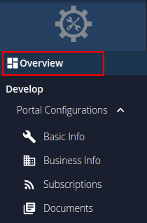

19. click Publish.<br />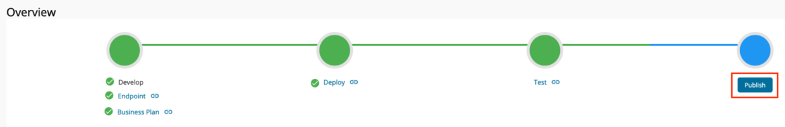

Follow the same steps to publish Payments and COF API. Refer the below table for the OpenAPI files and context values of Payments and COF APIs.

| API Name               | OpenAPI File                                                                                                                                                                                                                           | Context Value                 |
| ---------------------- | -------------------------------------------------------------------------------------------------------------------------------------------------------------------------------------------------------------------------------------- | ----------------------------- |
| PaymentInitiationAPI   | [payment-initiation-openapi.yaml](https://github.com/wso2/financial-services-accelerator/blob/4.0.0/financial-services-accelerator/accelerators/fs-apim/repository/resources/apis/Payments/payment-initiation-openapi.yaml)            | /open-banking/{version}/pisp  |
| ConfirmationOfFundsAPI | [funds-confirmation-openapi.yaml](https://github.com/wso2/financial-services-accelerator/blob/4.0.0/financial-services-accelerator/accelerators/fs-apim/repository/resources/apis/ConfirmationOfFunds/funds-confirmation-openapi.yaml) | /open-banking/{version}/cbpii |

Once you deploy the APIs an API resource will be created along with the role mentioned in the swagger on the Identity Server side.
